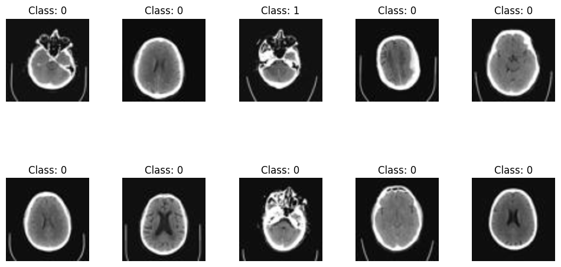
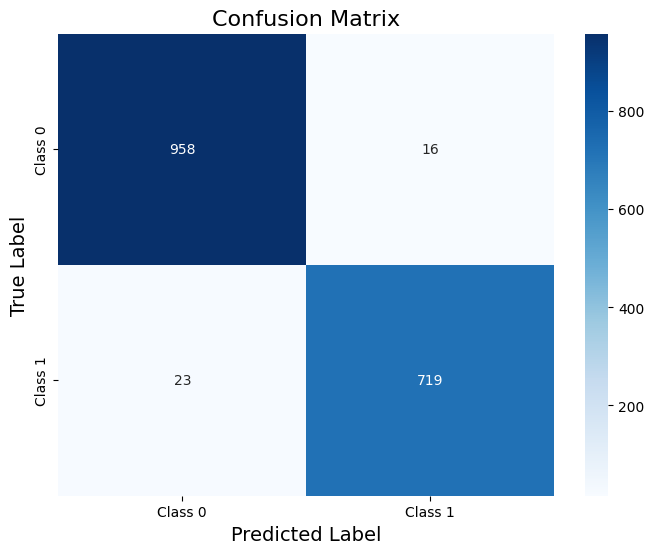
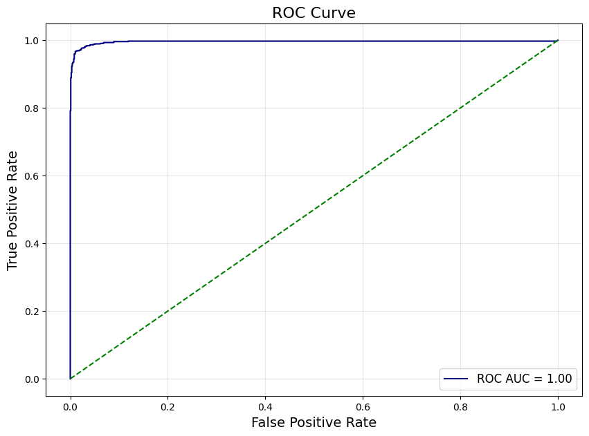
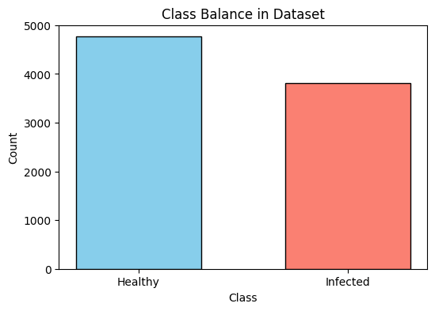
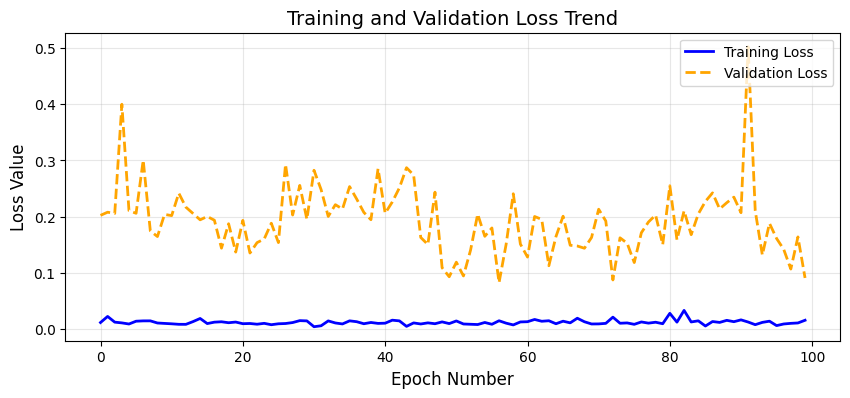
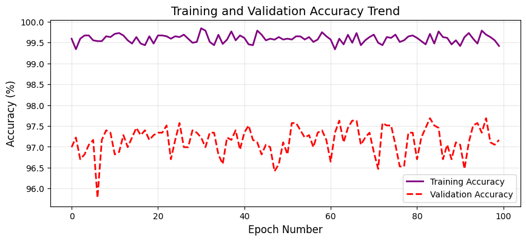

# Head CT Scan Classifier (PyTorch)


A neural network built from scratch in PyTorch that classifies **head CT scans** as **healthy** or **infected**. Trained on 8,580 images, it reaches **~98% accuracy** and an **ROC AUC of ≈ 1.00** on a held-out test set.

> Built for a Machine Learning course at LUMS (programming assignment 3). The assignment framed the task as a sci-fi story: spotting "Code Rot" in humanoid "Guardians" from their CT scans. Underneath, it is a standard binary image classification problem.

<p align="center">
  
</p>

---

## Results (test set: 1,716 scans)

| Metric | Value |
|---|---|
| Accuracy | **97.7%** (1,677 / 1,716 correct) |
| Precision (infected) | 97.8% |
| Recall / sensitivity (infected) | 96.9% |
| Specificity (healthy) | 98.4% |
| F1-score (both classes) | 0.97–0.98 |
| ROC AUC | ≈ 1.00 |

<p align="center">
  
  
</p>

Out of 1,716 test scans, the model missed **23 infected scans** (false negatives) and raised **16 false alarms** (false positives). In a medical screening setting, the false negatives are the costlier error. Lowering the 0.5 decision threshold would trade a few more false alarms for fewer missed infections.

---

## Approach

**1. Data and preprocessing**
- 8,580 grayscale head CT slices (64×64 JPEG), labelled `infected = yes / no` in `labels.csv`.
- Classes are moderately imbalanced: ~4,770 healthy vs ~3,810 infected.
- Each image is resized to 128×128, converted to one channel, and normalised to [−1, 1].

<p align="center"></p>

**2. Split:** 60% train / 20% validation / 20% test (`train_test_split`, `random_state=42`), served in mini-batches of 32 with `DataLoader`.

**3. Model:** a fully connected network (multilayer perceptron) on the flattened image:

```
16,384 (128×128 pixels) → 512 → BatchNorm → Dropout(0.5) → 256 → 128 → 64 → 1 → Sigmoid
                          ReLU activations between layers
```

**4. Training:** binary cross-entropy loss, Adam optimiser (learning rate 0.001), 100 epochs. The training loop is written by hand: `fit_one_epoch`, `evaluate` and `fit` track loss and accuracy on the training and validation sets every epoch.

<p align="center">
  
  
</p>

Training accuracy stays around 99.5%, while validation accuracy sits around 97% and validation loss is noisy. The gap is a sign of some **overfitting**. Early stopping or stronger regularisation would help.

**5. Error analysis:** all 39 misclassified test scans are plotted in the notebook. Many are slices from the **skull base** (dominated by bright bone and sinus structures) or the **very top of the head** (little brain tissue visible). These are the slices where the signal is weakest.

---

## Limitations and next steps

- **MLP, not CNN.** Flattening the image throws away its 2D structure. A small convolutional network would likely be more accurate and need far fewer parameters (the first layer alone has ~8.4M weights).
- **Possible slice-level leakage.** The split is random by image. Neighbouring slices from the same patient look very similar and can end up in both train and test, which may make the scores optimistic. A patient-level split needs patient IDs, which this dataset does not include.
- **No data augmentation or early stopping** yet. Both are easy wins for the overfitting seen in the curves.
- **Threshold fixed at 0.5.** For screening, choose the threshold from the ROC curve based on the cost of a missed infection.

---

## Repository structure

```
├── ct_scan_classifier.ipynb   # Full pipeline: load → visualise → split → model → train → evaluate → error analysis
├── data/
│   ├── HeadCT/                # 8,580 CT images (000000.jpeg … 009999.jpeg)
│   └── labels.csv             # filename, infected (yes/no)
├── images/                    # Charts used in this README
├── requirements.txt
└── README.md
```

## How to run

```bash
git clone https://github.com/Hasan8036/ct-scan-classifier-pytorch.git
cd ct-scan-classifier-pytorch
pip install -r requirements.txt
jupyter notebook ct_scan_classifier.ipynb
```

Training 100 epochs on a CPU is slow (30+ minutes). Running in Google Colab with a GPU runtime is much faster.

## Tech stack

`PyTorch` · `torchvision` · `scikit-learn` · `pandas` · `NumPy` · `Pillow` · `Matplotlib` · `Seaborn`

## Author

**Hasan Malik**: BS Computer Science, LUMS · MMA candidate, McGill University
GitHub: [@Hasan8036](https://github.com/Hasan8036)
